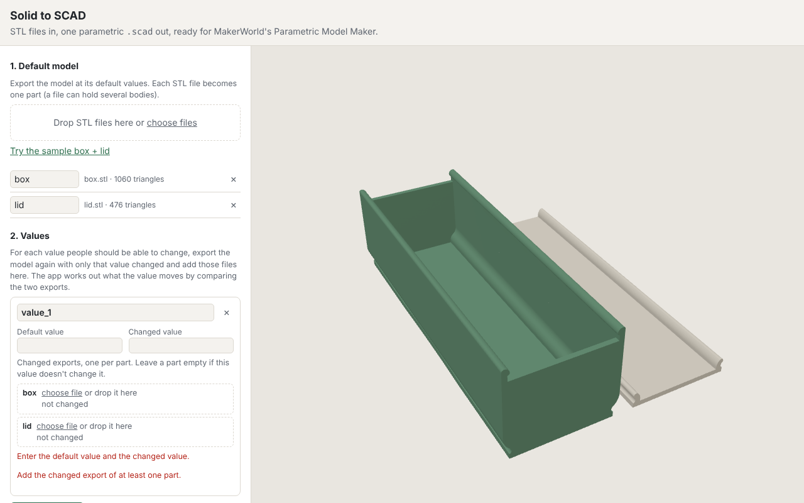
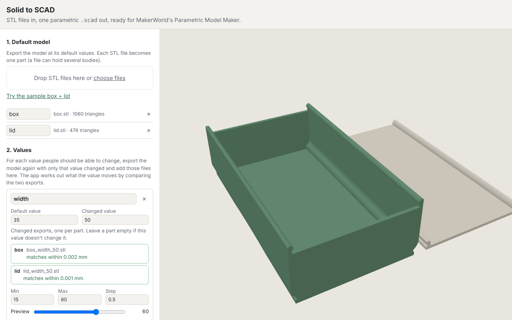
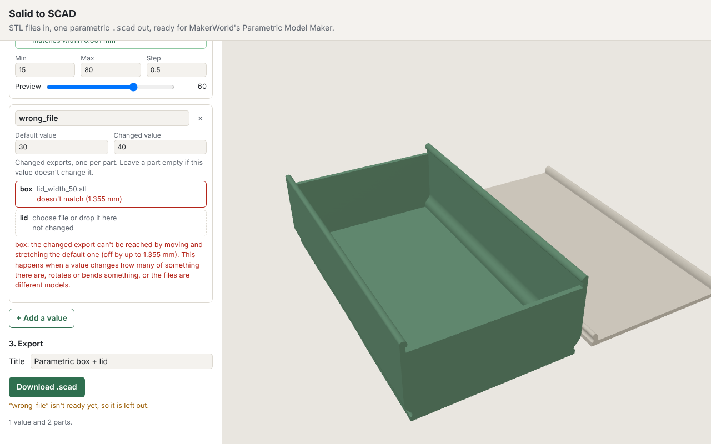

# Solid to SCAD

Turn STL files into one parametric OpenSCAD file that works in MakerWorld's
Parametric Model Maker (the OpenSCAD Customizer).

**Use it in the browser:** https://buddieh.github.io/Solid-to-SCAD/

Everything runs on your computer; files are never uploaded.

## How it works

You show the app how your model changes, and it learns the rule:

1. **Export the default.** Export the model (one STL per part) at its default values.
2. **Export one change per value.** For each value people should be able to set, export
   again with only that value changed, and note both values (for example width 35 and 50).
3. **Learn the change.** For each pair the app finds how every slice of the model moves
   along X, Y and Z, by pulling the default mesh onto the changed one. This is the way CAD
   families resize: some regions move without changing shape, some stretch, and features
   in between follow. Walls, fillets and the fit between parts stay as they were.
4. **Check the fit.** The app reports how closely the learned change reproduces the
   changed export. Within 0.05 mm it is exact for printing. Beyond 0.5 mm the value does
   something the app can't learn, and it is left out of the export.
5. **Export.** CAD exports split faces into many small triangles. They are merged with
   [manifold-3d](https://github.com/elalish/manifold) (within 0.001 mm), and the mesh is
   written into the `.scad` as `polyhedron()` data with a Customizer slider per value.
   Values between and beyond the examples are linear blends of the learned change, and
   values combine by adding their changes.

Checked against a box and lid exported from Revit: learned from the default and Revit's
own resized export, the result matches within 0.01 mm, and the `.scad` rendered in
OpenSCAD matches within 0.05 mm.

**What it can't learn:** values that change how many of something there are (an array
or a number of slots), and changes that aren't along X, Y or Z (rotations, bending,
twisting). The fit check catches these instead of exporting something wrong.

## Walkthrough

**1. Export the default model.** In your CAD tool, export each part as its own STL at
the default values. A part can hold several bodies. Drop the files on the app. Each one
becomes a part, and you can rename it (the name shows up in the Customizer's part list).



**2. Add a value.** For each value people should be able to set, export every part
again with *only that value changed*, then:

- name the value (this becomes the Customizer variable, e.g. `width`)
- enter the default and changed numbers (e.g. 35 and 50)
- add each part's changed export to its slot, or drop all of them on the card and
  they get matched to parts by file name. Leave a part empty if the value doesn't
  change it.

Each file shows how closely the learned change reproduces it. The app suggests a
Customizer range that can't fold the model inside out, and the preview slider shows
the result.



If a file doesn't match, that value is left out of the export and the card says why:



**3. Export.** Give it a title and download the `.scad`. On MakerWorld, upload it to
the Parametric Model Maker. Keep it to a few hundred KB, since MakerWorld has no
published limit, but very large files can time out.

### Getting good exports

- Export all files from the same model, in the same position and units. Don't move or
  re-center the model between exports.
- Change one value per pair. The size of the change doesn't matter much, but a clearly
  visible change (say 30–50%) gives the cleanest result.
- Values combine by adding their changes. That's exact when each value moves its own
  features, which is how CAD families usually behave. If two values move the same
  feature in ways that depend on each other, check the preview with both changed.
- Values that change a count (number of slots, an array) need a separate model per
  count. So do values that rotate or bend something.

## Running it locally

```sh
npm install
npm run dev     # builds the site and serves it at http://localhost:8080
npm test        # the OpenSCAD render test runs when openscad is on the PATH
npm run build   # writes the static site to _site/
```

The `pages` workflow deploys `main` to GitHub Pages on every push. There is no bundler.
The app is plain ES modules: `src/core/` is the library (used by the app, the CLI and
the tests), and `web/` is the page.

The sample uses a Revit box and lid. Its single-value exports (width, length and height
changed one at a time) were made with the zone stretch that matches Revit, see
`test/revit.test.js`.

## Command line

The command line still uses the first version's method, which finds stretch zones in a
single export automatically (it works for box-like models):

```sh
npm install
node bin/stl2scad.js box.stl lid.stl -o container.scad --title "My container"
```

The first file is the reference part: its outer size is what the width, length
and height sliders describe. Height only applies to the reference part.

## Contributing

Issues and pull requests are welcome. The most useful thing to send is a model that
doesn't learn well: the default export and the changed export for the value that fails,
plus the two numbers. Please run `npm test` before opening a pull request.

## License

[MIT](LICENSE). The bundled [three.js](https://github.com/mrdoob/three.js) and
[manifold-3d](https://github.com/elalish/manifold) keep their own licenses, and the
built site ships them next to the code.
